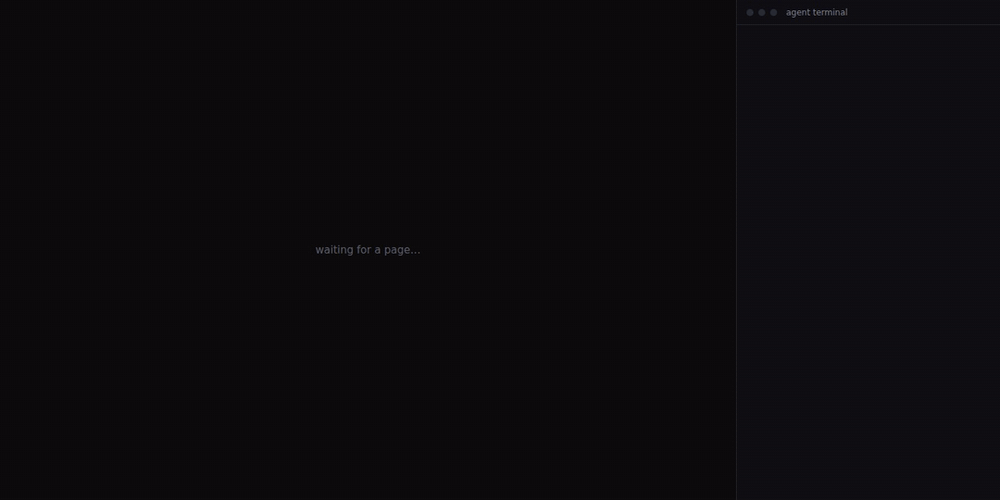

# austere-axi

[](https://www.npmjs.com/package/austere-axi)
[](https://www.npmjs.com/package/austere-axi)
[](https://www.jsdelivr.com/package/npm/austere-axi)
[](https://skills.sh/mandalorianbatman/austere-axi)
[](https://github.com/MandalorianBatman/austere-axi/actions/workflows/ci.yml)
[](https://www.npmjs.com/package/austere-axi)
[](LICENSE)

Review pages for coding agents. The agent writes a short [OpenUI Lang](https://github.com/thesysdev/openui) program, not HTML. You open it in the browser, click on any part, and write a note. The agent gets each note with the name of the statement it points at. It edits only those statements, and the page updates in place.



<sub>The real loop, about 30 s: [MP4](docs/demo.mp4) · [WebM](docs/demo.webm).</sub>

```
root = Stack([intro, flow, options, decide], "column", "l")
intro = Card([CardHeader("Session storage migration", "Redis → Postgres"), introText])
introText = MarkDownRenderer("Sessions are lost on failover. **Goal:** durable sessions, no forced logout.")
flow = Card([CardHeader("Request path"), flowDiagram])
flowDiagram = Architecture([client, api, pg], [toApi, toPg])
client = Node("Client", "external")
api = Node("API", "backend", "Node :8080")
pg = Node("Postgres", "database", "sessions table", "new")
toApi = Edge(client, api, "HTTPS", "emphasis")
toPg = Edge(api, pg, "SQL")
options = Card([CardHeader("Rollout options"), optionTable])
optionTable = Table([Col("Option", ["Big bang", "Dual-write"]), Col("Risk", [Tag("high", null, "sm", "danger"), Tag("low", null, "sm", "success")])])
decide = Form("rollout", Buttons([Button("Send decision", @ToAssistant("Decision: rollout"), "primary")]), [strategyField])
strategyField = FormControl("Rollout", RadioGroup("strategy", [RadioItem("Big bang", "", "bigbang"), RadioItem("Dual-write", "", "dualwrite")]))
```

[`examples/session-migration.html`](examples/session-migration.html) is a full page (KPIs, diagram, table, chart, diff, decision form) in about 1,000 tokens.

**Website:** [mandalorianbatman.github.io/austere-axi](https://mandalorianbatman.github.io/austere-axi/) has a [gallery](https://mandalorianbatman.github.io/austere-axi/gallery/) of example pages (postmortem, API review, PR summary, sprint plan) next to their source and token counts, and a [playground](https://mandalorianbatman.github.io/austere-axi/play/) where you edit OpenUI Lang and see the page with nothing installed.

## Why

The loop is the same as [lavish-axi](https://github.com/kunchenguid/lavish-axi). The difference: the agent never writes HTML, CSS or layout.

| | lavish-axi | austere-axi |
|---|---|---|
| Agent writes | Full HTML + CSS + SVG | OpenUI Lang statements |
| After feedback | Edits the HTML; the page reloads | Edits the named statements; the page patches in place |
| Feedback points at | CSS selector + text | Statement name and line, plus table cell, diff line, diagram node or selected text |
| Validation | Layout audit in the browser | `austere-axi check`, in Node, no browser |
| Look | Different for each agent | One dark design |

Fewer output tokens means faster pages and lower cost. From the [benchmark](docs/benchmark.md):

<!-- bench:start -->
Across 36 paired runs (6 review pages, 2 models), lavish-axi spent a median **3.2×** the output tokens of austere-axi to produce the same page, took **2.4×** as long and cost **2.5×** as much. Answering one reviewer note took **2.7×** the output tokens.
<!-- bench:end -->

The benchmark also shows where lavish-axi does better; read its caveats before quoting the numbers.

## Install

You need Node.js 22.18 or later.

**Let your agent do it.** Install the setup skill, then ask your agent to "set up austere-axi":

```sh
npx skills add MandalorianBatman/austere-axi --skill austere-setup
```

It checks Node, installs the `austere` skill, offers the optional items below, and opens a test page.

**Or do it yourself.** Agents can run the CLI with no install:

```sh
npx -y austere-axi --help
```

`-y` skips the npm prompt, so an agent does not stop on it. Optional:

```sh
npm install -g austere-axi                                  # `austere-axi` command, no npx
npx skills add MandalorianBatman/austere-axi --skill austere   # tells agents when to make a page; adds /austere
```

The `austere` skill is a stub that points at `--help` and `spec`, so it does not go out of date. A global install stays on its version until `npm update -g austere-axi`.

## Install as a Claude Code plugin

The plugin bundles the `austere` skill (and `/austere`), the `austere-setup` skill and the MCP server below:

```sh
claude plugin marketplace add MandalorianBatman/austere-axi
claude plugin install austere@austere-axi
```

In a session: `/plugin marketplace add MandalorianBatman/austere-axi`, then `/plugin install austere@austere-axi`. The MCP server runs `npx -y austere-axi mcp`, so it needs Node 22.18 or later and npm access. `claude plugin update austere` picks up new skill text; the CLI comes from npm each time.

## Use with MCP

`austere-axi mcp` is an MCP server on stdio. Its tools are `spec`, `check`, `open` (validate and open the review), `poll`, `reply`, `patch` and `end`. Each runs the CLI command of the same name and returns its output, so the review loop is the same as on the command line. `poll` returns `status: timeout` after 50 s by default, because many clients cancel longer tool calls; the agent polls again and nothing is lost. Pass `timeout_ms: 0` to wait until feedback arrives when your client allows long calls.

**Claude Desktop** (`claude_desktop_config.json`) and **Cursor** (`~/.cursor/mcp.json`, or `.cursor/mcp.json` in a project):

```json
{
  "mcpServers": {
    "austere": {
      "command": "npx",
      "args": ["-y", "austere-axi", "mcp"]
    }
  }
}
```

**Codex** (`~/.codex/config.toml`):

```toml
[mcp_servers.austere]
command = "npx"
args = ["-y", "austere-axi", "mcp"]
```

Or `codex mcp add austere -- npx -y austere-axi mcp`. On a machine with no screen, add `AUSTERE_AXI_NO_OPEN=1` to the server's `env` so `open` prints the link instead of launching a browser. The other [environment variables](#environment) work the same way. Pass absolute file paths: the server resolves relative ones against its own working directory, which depends on the client.

## Quick start

```sh
npx -y austere-axi spec              # component reference (read once per session)
npx -y austere-axi plan.html         # validate and open the page for review
npx -y austere-axi poll plan.html    # wait until the reviewer presses Send
```

`--help` prints the file skeleton and the full loop.

## How it works

```
agent writes plan.html ──► austere-axi plan.html ──► local server + browser review
                                                        │  reviewer annotates, picks options,
                                                        │  types, presses Send
agent edits statements ◄── austere-axi poll plan.html ◄─┘  (long-poll returns the batch)
          │
          └─► page updates in place and flashes the changed statements
```

- **A page is a plain `.html` file**: one runtime `<script>` tag and one `<script type="text/openui">` block. Opened directly, it loads the runtime from the CDN. Under review, the server serves a local copy.
- **Components**: 58 stock OpenUI components, plus `Architecture` (`Node`, `Edge`, `Group`), `Diff` and `FileTree`. `Mermaid` and nine shadcn-style components are bundled [packs](#components-and-packs).
- **Architecture diagrams** lay out automatically ([dagre](https://github.com/dagrejs/dagre)). The agent never writes coordinates. Each node and edge is a click target. `lanes` puts each group in a column; `tone` colors a box or line to show risk. Use Mermaid for sequences, state machines, ER and gantt.
- **Annotations** go to the smallest named statement under the click, with detail where it exists: table row and column, `file:+line` in a diff, a diagram node, or selected text. The reviewer can move a note to a parent section.
- **Buttons and forms** send feedback. `@ToAssistant("…")` sends a message with the form values. A button with no action sends its label.
- **Phone review**: when Tailscale runs, the server also listens on the tailnet IP and prints a phone link. The link carries your owner key; keep it to yourself. The review UI has a mobile layout.

## CLI

```
austere-axi                      sessions + usage
austere-axi <file>               validate + open a review   [--no-open] [--reopen]
austere-axi poll <file>          long-poll for feedback      [--agent-reply "..."] [--takeover]
austere-axi reply <file>         post a reply without polling
austere-axi end <file>           end the review as the agent
austere-axi login [file]         single-use link that signs a browser in as you (SSH, --no-open)
austere-axi feedback <file>      feedback no agent has answered yet   [--all] [--peek]
austere-axi check <file>         validate the program (no browser)    [--fix]
austere-axi patch <file>         merge statements from stdin into the program (reports dropped unreferenced ones)
austere-axi spec [group|pack...] component reference (~5.8k tokens; groups narrow it)
austere-axi components ...       list | search | show | add | remove | new | build
austere-axi export <file>        one self-contained HTML file, works offline
austere-axi hub on|off|status|list|notes|open   persistent server with an index of every page
austere-axi share <file> --as "<name>"   invite link for a teammate on your tailnet   [--auto]
austere-axi share list|revoke           see invites, cut one off
austere-axi stop                 stop the background server
austere-axi mcp                  MCP server on stdio (see Use with MCP)
```

Output is compact YAML for agents. Each `poll` item has its statement and that statement's line, so the agent does not need to read the file again.

Session rules:

- One poll listens on a session at a time.
- Feedback sent while no agent listens waits for the next poll.
- A review the user ended does not open again unless you pass `--reopen`.
- If all review tabs stay closed, `poll` returns `browser_disconnected`: 10 s after a tab closes, or 5 min after a dropped connection (for example, a locked phone).
- `feedback <file>` returns notes no agent has answered, also from earlier days. Reading them marks them received; `reply` marks them answered.

## Components and packs

`spec` covers the common components (~5.8k tokens). Rare ones (area and scatter charts, sliders, switches, editable tables, …) are in the library but not in `spec`. Find them with `components`:

```sh
austere-axi components                  # every component, by group
austere-axi components search scatter   # search by name, group, description
austere-axi components show AreaChart   # signature, notes, example
```

**Packs** add components. A pack is an npm package with `dist/pack.js` (the components, a few KB) and `dist/catalog.json` (signatures, examples, schema).

```sh
austere-axi components add austere-pack-gantt --trust   # npm name, folder, or .tgz
austere-axi check --fix plan.html                       # adds the pack tag to the page
```

A page names its packs in the head, so it renders wherever you open it:

```html
<meta name="austere-packs" content="austere-pack-gantt@1.2.0 sha384-…">
```

- Under review, the server serves installed packs only while they match the hash in `~/.austere-axi/packs.json`. Opened directly, the page loads them from jsDelivr with Subresource Integrity. `export` inlines them.
- A pack component with no pack tag is a `missing-pack` error. `check --fix` repairs it.
- Mermaid ships as a bundled pack. It loads only when the page calls `Mermaid(...)` and needs no tag.
- The `shadcn` pack ships the same way. It adds `Progress`, `Avatar`, `AvatarGroup`, `Tooltip`, `HoverCard`, `Breadcrumb` (`BreadcrumbItem`), `Kbd`, `Skeleton`, `Calendar` and `Timeline` (`TimelineItem`). They are read-only. Find them with `austere-axi components search`.
  ```
  rollout = Progress(64, "Rows migrated")
  freeze = Calendar("2026-11", ["2026-11-04 Code freeze"])
  ```

**Trust.** Pack code runs inside your review pages, where notes and button presses also come from. Packs under `@austere-axi/` on npm install directly. Other npm packs and any `.tgz` need `--trust`; read them first. A local folder counts as your own. A page with third-party packs shows a warning, and `poll` tells the agent.

**Write a pack:** [Writing a pack](docs/writing-a-pack.md) walks through one from scaffold to `npm publish`, using [austere-pack-gantt](https://github.com/MandalorianBatman/austere-pack-gantt), a Gantt chart pack built outside this repo, as the example. The short version:

```sh
austere-axi components new austere-pack-milestones
cd austere-pack-milestones && npm install && npm run build
austere-axi components add .
```

Each component uses `austereComponent` from `austere-axi/pack`: a PascalCase name, zod props in positional order (append-only after you publish), a one-line description and an example. The build loads the pack in Node, so build only code you trust. Publish with `npm publish`.

## Hub

The server starts when needed and stops after 30 idle minutes. `hub on` keeps it running and indexes every page you open or check:

```sh
austere-axi hub on      # http://127.0.0.1:4388/: pages by project and day, with search
austere-axi hub list    # the same, for an agent: [words] [--project dir]
austere-axi hub notes   # every note, same for an agent: [words] [--project dir] [--unanswered]
austere-axi hub off     # back to on-demand; the index stays
```

`/notes` lists every note on every page, newest first, with search, status and project filters. The home page shows which reviews are live and how much feedback the agent has answered. The index is SQLite (`~/.austere-axi/hub.db`), copied from the session files; the review loop does not need it.

## Team review

Teammates on your tailnet can review a page and leave notes under their own name. The server still runs on your machine. There are no accounts and no hosted service.

```sh
austere-axi share plan.html --as "Ana"           # prints a link; notes wait for you
austere-axi share plan.html --as "Bo" --auto     # Bo's notes go straight to the agent
austere-axi share list [--links]                 # who has a link
austere-axi share revoke Ana                     # name or id; takes effect at once
```

Send the link to the teammate. The link needs Tailscale (or `AUSTERE_AXI_HOST`); without one, `share` stops with an error.

- **Hold (default):** a teammate's note waits in your side panel. Press **Send** on one note, or **Send all**. **Discard** removes it. Held notes are not in `poll` or `feedback`, so the agent does not see them until you send them. Each teammate can have up to 200 notes held at once; more are refused until you send or discard some.
- **Auto:** the note goes to the agent without your approval.
- **Author:** `poll` and `feedback` show `from: <name>` on each teammate's note. Your own notes have no `from`. The hub Notes view shows the author and can filter on it.
- **Reviewers can:** read the page and the conversation, and add notes. They cannot end the review, export, or send held notes.

Trust model: anyone who has the link, and can reach your machine on the tailnet, can post notes under that name until you revoke it. Share links only with people you trust, and revoke when the review is done. The link holds a random 192-bit token. Opening it shows a "Continue as <name>" button; pressing it (a same-origin POST) trades the token for a cookie and the address bar drops it. A link opened from another site therefore cannot switch your browser into a reviewer.

A request without a valid invite or the owner key is refused, on loopback too. The hub and its Notes view are yours only. Your own phone link carries the owner key (`~/.austere-axi/owner.key`); do not forward it. To make all old phone links and owner cookies stop working, delete that file and restart the server. A reverse proxy on the same machine gets no owner rights from looking local.

## GitHub Action

Post an austere review page on every pull request. The action runs `austere-axi check` on the pages you commit, exports each one as a self-contained HTML file with `austere-axi export`, uploads them as a workflow artifact, and posts or updates **one** comment on the PR with a summary and a download link.

```yaml
# .github/workflows/austere.yml
name: austere review
on: pull_request

permissions:
  contents: read
  pull-requests: write   # to post the comment

jobs:
  review:
    runs-on: ubuntu-latest
    steps:
      - uses: actions/checkout@v7
      - uses: MandalorianBatman/austere-axi/action@main   # pin a release tag or SHA once you settle
        with:
          pages: reviews/*.html
```

| Input | Default | |
|---|---|---|
| `pages` | required | paths or globs, one per line, relative to the workspace |
| `version` | `latest` | austere-axi version from npm; pin it for reproducible runs |
| `artifact-name` | `austere-review` | workflow artifact that holds the exported pages |
| `retention-days` | repository default | artifact retention |
| `comment` | `true` | `false` leaves only the artifact and the job summary |
| `comment-tag` | `default` | names the sticky comment; use one per use of the action in the same PR |
| `github-token` | `github.token` | needs `pull-requests: write` to comment |

Outputs: `ok` (`true` when every page passed) and `artifact-url`.

- **A failing check fails the job.** The `check` output, with each error's statement and line, is in the log and in the job summary; pages that passed are still exported.
- **Fork PRs** get a read-only token, so the comment is skipped with a warning. The job summary and the artifact still carry the report.
- **Sticky comment:** the action updates only a marked comment posted by its own token's account (a bot account for `github.token`). A comment someone else writes with the same marker is left alone, and the action posts its own.
- **Triggers:** use `pull_request`. Do not use `pull_request_target` to run pages from a fork.
- **Artifact:** GitHub zips it and requires a login to download it. Unzip and open the HTML in a browser; it works offline. A Pages preview is not part of the action.
- The action lives in this repository, under `action/`, so one ref pins the action and the CLI contract it calls. `version` still picks the CLI.

## Environment

| Variable | Default | |
|---|---|---|
| `AUSTERE_AXI_PORT` | `4388` | server port |
| `AUSTERE_AXI_STATE_DIR` | `~/.austere-axi` | sessions, owner key, server log (mode 0700 on macOS and Linux) |
| `AUSTERE_AXI_NO_OPEN` | | `1` = never open a browser |
| `AUSTERE_AXI_HOST` | | extra bind address (never `0.0.0.0`) |
| `AUSTERE_AXI_NO_TAILSCALE` | | `1` = loopback only |
| `AUSTERE_AXI_LINK_HOST` | | host in the printed remote link (`http://<host>:<port>`) |
| `AUSTERE_AXI_LINK_URL` | | full origin of the printed remote link, e.g. `https://austere.example.com` behind a TLS proxy; the host is accepted without `ALLOWED_HOSTS` |
| `AUSTERE_AXI_ALLOWED_HOSTS` | | extra `Host` headers to accept (reverse proxy) |
| `AUSTERE_AXI_DISCONNECT_GRACE_MS` | `300000` | how long a dropped connection can stay away before `poll` returns; `0` disables |
| `AUSTERE_AXI_IDLE_TIMEOUT_MS` | `1800000` | idle shutdown; `0` disables (the hub never idles out) |
| `AUSTERE_AXI_NPM_REGISTRY` | `npm_config_registry`, else npmjs | where `components add` gets packs |

## Security

The server binds to loopback, plus the Tailscale IP when Tailscale is up. It never binds to all interfaces.

- Loopback is not the owner: other OS users on the machine can reach it too. The owner key in `owner.key` is.
  - `/api/*` answers only loopback callers that send the owner key, and refuses browser requests. `/api/health` needs no key; it proves the server holds the key with an HMAC of its port and the CLI's nonce, so the CLI never talks to, or hands the key to, another program on its port.
  - A browser signs in with a single-use login code: when the CLI opens your browser, it asks the server for a code and opens the page with it; the server swaps it for the owner cookie and drops it from the address bar. The key is never on a command line or in printed output. A code works once and for 60 seconds. Another local user who reads it from the process list in that time can use it first; your browser then shows "used already", and `austere-axi login` gives you a new one.
  - A printed `url` works in a browser that already has the cookie. For any other browser (SSH with a forwarded port, `--no-open`, a second browser), run `austere-axi login [file]` and open the link it prints.
  - The owner cookie is an HMAC of the key, not the key. Browsers share `127.0.0.1` cookies across ports, so any program listening on another local port that your browser visits can read it. With it, that program can open your pages and the hub as you in a browser, but not call `/api/*`, which needs the key.
- On macOS and Linux the state dir is made mode 0700 on every run, and new files in it (`owner.key`, sessions, `server.log`, `hub.db`) are mode 0600. Files an older version created keep their old mode, behind the 0700 dir. On Windows, file modes do not apply: the state dir is protected only by your user profile's permissions.
- `Host` headers must be on an allowlist (DNS-rebinding defense).
- Browser routes that change state refuse a foreign `Origin`.
- Invite tokens are random, compared in constant time, and kept out of the log. A reviewer link can only add notes to its own page. See [Team review](#team-review).
- The page runs in a sandboxed iframe with no same-origin access. Packs run there too. Page files are also served with a `Content-Security-Policy: sandbox` header, so the page stays sandboxed when opened in a popup or its own tab. In review, links that open a new window are opened by the review page, and only if they are external `http(s):` or `mailto:` links. A popup the frame opens any other way stays sandboxed.
- The server serves files only from the page's own directory, with no dotfiles.
- Third-party packs need `--trust`. Installed packs must match their lockfile hash; CDN loads use Subresource Integrity.

OpenUI's Node side has PostHog telemetry. The CLI sets `OPENUI_TELEMETRY_DISABLED=1`. The browser runtime sends no telemetry.

## Not in v1

- Image attachments in feedback.
- Live data: `Query` and `Mutation` are off, so pages are static.
- Themes: one dark theme only.
- Hosted sharing: use `export` to make one offline file.

## Development

```sh
npm install
npm run build     # dist/: runtime, packs, pack kit, Mermaid, spec, catalog, review UI, cli.mjs
npm test
npm run typecheck # tsc over src/cli, src/shared and the pack types
node dist/cli.mjs examples/session-migration.html
npm run site      # _site/: the website (needs Chrome or CHROME_PATH); see site/ and examples/
```

| Path | Contents |
|---|---|
| `src/runtime/components/` | Custom components (`Architecture` family, `Diff`, `FileTree`), one file each |
| `src/runtime/stock.js` | Which stock components ship, which stay out of `spec`, their groups |
| `docs/` | [Writing a pack](docs/writing-a-pack.md) |
| `packs/` | Packs bundled with austere-axi (`mermaid`, `shadcn`) |
| `src/runtime/pack-api.js`, `src/pack-kit/` | `austere-axi/pack` and the `components build` pipeline |
| `src/shared/catalog.js` | Component catalog and prompt tiers |
| `src/runtime/` | Library, annotation layer, review bridge, styles |
| `src/chrome/` | Review UI around the page iframe |
| `src/cli/` | CLI, server, sessions, `check`, `export`, packs, hub |
| `action/` | The [GitHub Action](#github-action) (not published to npm) |
| `skills/` | Published skills: `austere`, `austere-setup` |
| `.claude-plugin/` | Claude Code marketplace and plugin manifest (in git, not in the npm package) |

Maintainer guides (not published): [`AGENTS.md`](AGENTS.md), [`.agents/skills/add-component`](.agents/skills/add-component/SKILL.md) to add a component, [`.agents/skills/review-change`](.agents/skills/review-change/SKILL.md) before you commit. Tests enforce the component rules: every component has a group, `spec` stays in its token budget, released prop orders are append-only (`npm run signatures`), and every example passes `check`.

Visual checks: `npm run gallery`, `npm run shot`, and `npm run test:browser` (real review loop in headless Chrome; needs Chrome or `CHROME_PATH`).

Website: `site/` holds the hand-written pages and CSS, `examples/` feeds the gallery (add a file there and it appears with a generated thumbnail), `scripts/site.mjs` builds `_site/`, and `.github/workflows/pages.yml` deploys it to GitHub Pages on every push to `main`. Examples need a `<meta name="description">` for the gallery blurb. None of it is published to npm.

Playground (`/play/`, source in `site/play/`): a textarea editor beside a sandboxed frame running `dist/austere.js`. It plays the part of the review chrome over the same `postMessage` bridge, so edits re-render in place and clicks arrive as the annotations `poll` prints. Problems come from `src/shared/check-program.js`, the same code as `austere-axi check`, bundled for the browser by `scripts/site.mjs` (with the spec, the component catalog and one template per example in `play/data.json`). The program travels in the URL hash (`#code=v1.<deflate-raw, base64url>`), so there is no server. `test/browser/play.browser.test.js` drives it in headless Chrome as part of `npm run test:browser`. Packs other than the bundled ones are not available there.

Benchmark against lavish-axi: `npm run bench` (needs model keys; see [docs/benchmark.md](docs/benchmark.md)). `npm run bench:report` rebuilds its tables from the committed results.

**CI** builds and tests every push to `main` and every pull request (Node 22, 24, 26 on Linux; Node 24 on Windows; browser suite). `action.yml` runs the GitHub Action on fixture pages (`test/fixtures/action/`). **Release:** bump `version` in `package.json`, push, and publish a GitHub Release. `publish.yml` tests again and publishes to npm with trusted publishing.

## License

MIT. Builds on [OpenUI](https://github.com/thesysdev/openui) (MIT). The review loop design comes from [lavish-axi](https://github.com/kunchenguid/lavish-axi) (MIT).
