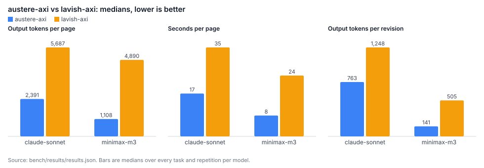

# Benchmark: austere-axi vs lavish-axi

Claim under test: fewer output tokens means faster pages and lower cost. The same model gets the same review-page request twice, once with austere-axi's guidance (write an OpenUI Lang program) and once with lavish-axi's (write the HTML), then one reviewer note to answer. Measured: output tokens, time, cost, first-try validity under the tool's own check, and the cost of the revision.

<!-- results:start -->
Across 36 paired runs (6 review pages, 2 models), lavish-axi spent a median **3.2×** the output tokens of austere-axi to produce the same page, took **2.4×** as long and cost **2.5×** as much. Answering one reviewer note took **2.7×** the output tokens.

Versions: austere-axi 0.4.1, lavish-axi 0.1.96. 72 trials, last run 2026-11-06.

### The page

Medians, except cost (mean per page). *First try*: the tool's own validator passed on the model's first answer. *Fix turns*: opening the page told the agent to fix something, so it got one more turn (median output tokens of that turn in brackets). *Tokens*, *time* and *cost* include the fix turn. *Clean render*: no page errors and no sideways scrolling at 1440 and 390 px. *Facts kept*: the task's facts that appear on the page.

| Model | Tool | Runs | Valid first try | Fix turns (tokens) | Fixed | Output tokens | Time | Cost | Clean render | Facts kept |
|---|---|--:|--:|--:|--:|--:|--:|--:|--:|--:|
| claude-sonnet (sonnet) | austere-axi | 18 | 18/18 (100%) | 0 | – | 2,391 | 16.9 s | $0.025 | 18/18 (100%) | 156/156 (100%) |
| claude-sonnet (sonnet) | lavish-axi | 18 | 17/18 (94%) | 0 | – | 5,687 | 35.0 s | $0.059 | 18/18 (100%) | 156/156 (100%) |
| minimax-m3 (MiniMax-M3) | austere-axi | 18 | 7/18 (39%) | 11 (184) | 9/11 | 1,108 | 8.2 s | $0.0023 | 18/18 (100%) | 156/156 (100%) |
| minimax-m3 (MiniMax-M3) | lavish-axi | 18 | 16/18 (89%) | 0 | – | 4,890 | 23.9 s | $0.0067 | 16/18 (89%) | 156/156 (100%) |

### One revision round

The reviewer leaves one note; the agent answers with the tool's cheapest edit (statements for `austere-axi patch`, SEARCH/REPLACE edits for the lavish-axi HTML). An edit that does not apply gets its error back once; both attempts count. *Ok*: applied, contains what the note asked for, and did not make a valid page invalid.

| Model | Tool | Output tokens | Time | Cost | Ok |
|---|---|--:|--:|--:|--:|
| claude-sonnet (sonnet) | austere-axi | 763 | 7.3 s | $0.044 | 18/18 (100%) |
| claude-sonnet (sonnet) | lavish-axi | 1,248 | 12.3 s | $0.101 | 18/18 (100%) |
| minimax-m3 (MiniMax-M3) | austere-axi | 141 | 1.8 s | $0.0009 | 16/18 (89%) |
| minimax-m3 (MiniMax-M3) | lavish-axi | 505 | 5.1 s | $0.0035 | 16/18 (89%) |

### lavish-axi ÷ austere-axi (median of paired ratios)

Each pair is the same model, task and repetition. Above 1× means lavish-axi used more.

| Model | Pairs | Output tokens, first try | Output tokens, page | Time, page | Cost, page | Revision tokens | Revision time | Revision cost |
|---|--:|--:|--:|--:|--:|--:|--:|--:|
| claude-sonnet (sonnet) | 18 | 2.4× | 2.4× | 2.2× | 2.3× | 2.1× | 1.5× | 2.2× |
| minimax-m3 (MiniMax-M3) | 18 | 5.1× | 4.9× | 3.1× | 2.8× | 5.3× | 2.5× | 4.1× |
| **all** | 36 | 3.5× | 3.2× | 2.4× | 2.5× | 2.7× | 1.7× | 2.7× |

### Per task (median output tokens per page, fix turn included)

| Task | Model | austere-axi | lavish-axi | Tokens ÷ | Time ÷ | Revision tokens ÷ |
|---|---|--:|--:|--:|--:|--:|
| Migration plan | claude-sonnet | 1,847 | 6,120 | 4.0× | 3.0× | 2.2× |
| Migration plan | minimax-m3 | 981 | 4,597 | 4.9× | 5.5× | 4.8× |
| Code review | claude-sonnet | 2,285 | 4,268 | 1.8× | 1.6× | 1.9× |
| Code review | minimax-m3 | 1,364 | 3,680 | 2.7× | 1.0× | 8.0× |
| Architecture decision | claude-sonnet | 2,552 | 5,689 | 2.5× | 2.4× | 3.1× |
| Architecture decision | minimax-m3 | 939 | 5,565 | 5.9× | 3.1× | 3.7× |
| Comparison table | claude-sonnet | 2,345 | 5,902 | 2.5× | 2.4× | 3.6× |
| Comparison table | minimax-m3 | 1,137 | 4,756 | 4.9× | 1.8× | 5.7× |
| Dashboard | claude-sonnet | 2,497 | 5,511 | 2.1× | 2.0× | 1.1× |
| Dashboard | minimax-m3 | 1,321 | 4,715 | 3.6× | 4.8× | 1.1× |
| Release triage | claude-sonnet | 2,436 | 6,042 | 2.3× | 1.9× | 1.8× |
| Release triage | minimax-m3 | 1,093 | 5,259 | 5.1× | 3.9× | 12.9× |
<!-- results:end -->



## Reproduce

```sh
npm install
MINIMAX_API_KEY=… npm run bench      # builds, installs lavish-axi into bench/, runs, writes the report
```

Requires Node 22.18+, Chrome (or `CHROME_PATH`), network access (pages load CSS and scripts from CDNs), and:

| Model id (`bench/models.json`) | Backend | Credentials |
|---|---|---|
| `minimax-m3` (default) | MiniMax-M3 over its Anthropic-compatible API | `MINIMAX_API_KEY` |
| `claude-sonnet` (default) | Claude Sonnet through the `claude` CLI in print mode, no tools | a Claude Code login, or `ANTHROPIC_API_KEY` |
| `claude-sonnet-api` | Claude Sonnet 5.5 over the Anthropic API | `ANTHROPIC_API_KEY` |

- Options: `npm run bench -- --models claude-sonnet-api --tasks code-review,dashboard --reps 3 --concurrency 3`.
- Runs resume: trials already in `bench/results/results.json` are skipped, so an interrupted run or an added model runs only what is missing. `--fresh` starts over.
- `npm run bench:report` rebuilds the tables, the chart and the headline in [How it works](how-it-works.md) from `results.json` without calling a model.
- Every model output is committed under `bench/results/pages/<model>/<task>/`: first page (`austere-1.html`, `lavish-1.html`), fix reply if any, revision reply and revised page. Open any in a browser.

## Method

### Tasks

Six review pages, each with a fixed prompt holding every fact the page needs (`bench/tasks.ts`):

| Task | What the page has to show |
|---|---|
| Migration plan | Redis → Postgres sessions: goal, request path, four phases, two risks, cost, and a rollout choice the reviewer sends back |
| Code review | A PR diff and four findings with severities, each next to its code, and a verdict |
| Architecture decision | An ADR: context, three options compared on four criteria, the decision, consequences, Accept/Reject |
| Comparison table | Four vector databases on six criteria, with a shortlist the reviewer edits with checkboxes |
| Dashboard | A weekly service-health page: four KPIs, two daily series, incidents, action items |
| Release triage | Four bugs, each with a fix / defer / won't-fix choice, sent back together |

### What each agent sees

System prompt: the tool's own guidance, captured from its CLI at the start of the run:

- **austere-axi:** `austere-axi --help` and `austere-axi spec`.
- **lavish-axi:** `lavish-axi --help`, `lavish-axi design`, and `lavish-axi playbook <id>` for each playbook matching the task (its help says to open every matching playbook before writing HTML). Playbooks per task: `bench/tasks.ts`.

User prompt, same for both: the task, then "write the page to this file; reply with the complete file in one code block". No tools; each turn is one model call.

### Turns

1. **Page.** The model writes the file.
2. **Fix (only if the tool asks).** The tool's own open-time check runs; if it asks for a fix, the agent gets that output and one turn.
   - austere-axi: any error from `austere-axi check` (the same errors `austere-axi <file>` prints).
   - lavish-axi: a warning printed by `lavish-axi <file>`, such as `self_paint_warning`. Its layout audit does not trigger a fix (findings wait in the reviewer's Layout issues inbox).
3. **Revision.** One reviewer note per task, anchored to text on the page (e.g. "Add a third risk: connection pool exhaustion…" on the risks table).
   - The note arrives in the shape the tool's `poll` returns: austere-axi gives statement name, line and source; lavish-axi gives a CSS selector and the element's text, both found in the rendered page.
   - The model answers with the tool's cheapest edit: statements for `austere-axi patch` (same name replaces, new name adds), or SEARCH/REPLACE edits to the HTML (as an agent's Edit tool would).
   - An edit that does not apply gets its error back once.

### Measures

- **Output tokens:** as the provider bills them, thinking included.
- **Time:** wall-clock time of the model call, measured by the harness. With the `claude` CLI it includes starting the CLI.
- **Cost:** for API models, tokens × the published price in `bench/models.json` (input, output, cache reads). For `claude-sonnet`, the `total_cost_usd` the CLI reports.
- **Valid first try:** the tool's own validator passed on the model's first answer. austere-axi: `austere-axi check` (syntax, component names, prop types, references). lavish-axi: no open-time warning, and no error from lavish-axi's own layout audit, read from the real review page in headless Chrome at 1440 × 900 and 390 × 844.
- **Clean render (both tools):** no page error and no sideways scrolling at 1440 and 390 px wide, in headless Chrome.
- **Facts kept:** how many of the task's key facts (numbers, names, IDs) appear on the page. A cheap guard against a short page that is short because it left things out.
- **Revision ok:** the edit applied, the page contains what the note asked for, and a page that passed its validator still does.
- **Ratios** are lavish-axi ÷ austere-axi for the same model, task and repetition, then the median over pairs. "Page" numbers include the fix turn.

## What the numbers say

Notes on the committed run in `bench/results/` (austere-axi 0.4.1, lavish-axi 0.1.96, 2026-11-06). A rerun updates the tables above, not these notes.

- **The claim holds, by less than "a few hundred tokens instead of a whole page" suggests.**
  - Per page, lavish-axi used a median 3.2× the output tokens, 2.4× the time, 2.5× the cost.
  - The gap depends on the model: Claude Sonnet wrote fuller austere-axi programs (~2,400 tokens, a third thinking): 2.4×. MiniMax-M3 wrote ~1,100: 4.9×.
  - Every lavish-axi page cost more output tokens than its austere-axi pair.
- **Time and cost shrink less than tokens.**
  - Each call has fixed start-up and time to first token.
  - Cost covers input, which is similar for both: guidance is ~7,400 tokens for austere-axi, ~10,800 for lavish-axi (MiniMax-M3, first turn).
- **Revisions are closer than a full rewrite.** The lavish-axi agent edited HTML in place with SEARCH/REPLACE: 2.7× the output tokens of an austere-axi patch, not the 5×–10× of a rewrite.
  - A note changing one value (the dashboard's incident row): about equal (1.1×).
  - A note adding structure (a multi-column row, a new form option): lavish-axi repeats markup and classes; austere-axi adds a line or two.
- **lavish-axi wins first-try validity with the weaker model.**
  - MiniMax-M3: austere-axi passed `check` first try 7/18; lavish-axi's checks passed 16/18.
  - Most austere-axi errors were props in the wrong position or type (46 of 71 were `type-mismatch`, e.g. a label where `variant` goes, an object where a string `defaultValue` goes).
  - One fix turn (~180 tokens) repaired 9 of 11; the other 2 (both the comparison table's `CheckBoxGroup`) stayed invalid.
  - Fix turn included, MiniMax-M3's austere-axi pages still took 4.9× fewer tokens. Claude Sonnet passed `check` on all 18 first tries.
- **The two first-try numbers measure different things.**
  - `austere-axi check` type-checks every prop; on failure `austere-axi <file>` lists the errors and tells the agent to fix them.
  - lavish-axi checks only layout, leniently: two MiniMax-M3 pages scrolled sideways at 390 px unflagged; three others were flagged for clipped text, and those findings wait for the reviewer, not the agent.
- **Revision success tied: 34/36 each.**
  - lavish-axi: two SEARCH blocks that did not match the file, twice in a row.
  - austere-axi: one partial edit on a still-invalid page, and one silent drop: the model added a statement for BUG-330 without referencing it from the table; `austere-axi patch` dropped it, still reported `status: patched` and `check: ok`, and did not tell the agent. That is an austere-axi bug: `patch` should keep the statement or warn that nothing references it.
- **Both tools kept every fact** (all 72 pages). austere-axi pages are shorter because the agent writes no markup, CSS or layout, not because content is missing. Trade-off: every austere-axi page shares one fixed design; each lavish-axi page has its own, which some of its extra tokens pay for.

## Threats to validity

- **No tools, one call per turn.** Real agents read files and run the CLI; here guidance is pasted in and the model gets only the one fix and one retry. Extra reading is input tokens both tools would pay, but absolute numbers are lower than in a real session.
- **lavish-axi's design step is skipped.** Its guidance looks for the project's design system before falling back to Tailwind + DaisyUI; the prompt says there is none, so every page uses the fallback.
- **Feedback is simulated.** Note text is identical; the anchor (statement name, or selector and text) is found by the harness, not a person clicking. The edit formats stand in for each tool's normal path; rewriting a whole lavish-axi file would cost far more.
- **Validators differ.** `austere-axi check` is a strict static check of every prop; lavish-axi's audit only looks at layout. "Valid first try" measures each tool's own gate, not page quality.
- **No human quality scoring.** "Facts kept" checks presence only. Look at the committed pages before judging which suits your reviewers.
- **Small sample.** Six tasks, two models, three repetitions. Medians resist outliers, but sampling still moves numbers; rerun with `--reps 5` for tighter results.
- **Time depends on the provider.** Calls ran four at a time against shared endpoints; queueing and load affect wall time more than token counts.
- **The `claude` CLI adds overhead.** ~12k input tokens of its own system context per call (cached after the first) and process start-up in every time. Both tools pay it; it pulls Claude's cost and time ratios toward 1× compared with an API call.
- **Versions move.** Guidance is captured live, so a new release of either tool changes the prompt; rerun to compare.
- **Who wrote it.** austere-axi's maintainers wrote the benchmark and picked the tasks. Every prompt, raw result and page is in this repository to check or rerun.
