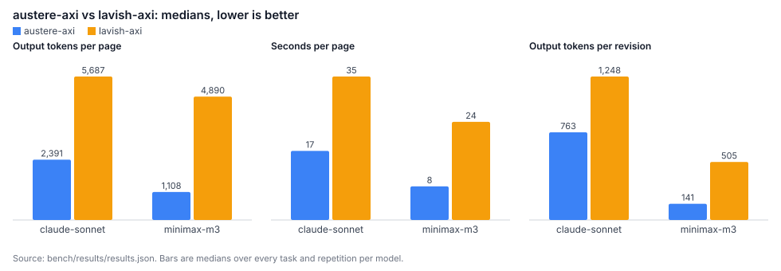

# Benchmark: austere-axi vs lavish-axi

The README says: fewer output tokens means faster pages and lower cost. This benchmark puts numbers on that. The same model gets the same review-page request twice, once with austere-axi's guidance (write an OpenUI Lang program) and once with lavish-axi's (write the HTML), then one reviewer note to answer. We count output tokens, time, cost, whether the page passed the tool's own check on the first try, and what the revision cost.

<!-- results:start -->
Across 36 paired runs (6 review pages, 2 models), lavish-axi spent a median **3.2×** the output tokens of austere-axi to produce the same page, took **2.4×** as long and cost **2.5×** as much. Answering one reviewer note took **2.7×** the output tokens.

Versions: austere-axi 0.4.1, lavish-axi 0.1.96. 72 trials, last run 2026-11-06.

### The page

Medians, except cost (mean per page). *First try*: the tool's own validator passed on the model's first answer. *Fix turns*: opening the page told the agent to fix something, so it got one more turn (median output tokens of that turn in brackets). *Tokens*, *time* and *cost* include the fix turn. *Clean render*: no page errors and no sideways scrolling at 1440 and 390 px. *Facts kept*: the task's facts that appear on the page.

| Model | Tool | Runs | Valid first try | Fix turns (tokens) | Fixed | Output tokens | Time | Cost | Clean render | Facts kept |
|---|---|--:|--:|--:|--:|--:|--:|--:|--:|--:|
| claude-sonnet (sonnet) | austere-axi | 18 | 18/18 (100%) | 0 | – | 2,391 | 16.9 s | $0.025 | 18/18 (100%) | 156/156 (100%) |
| claude-sonnet (sonnet) | lavish-axi | 18 | 17/18 (94%) | 0 | – | 5,687 | 35.0 s | $0.059 | 18/18 (100%) | 156/156 (100%) |
| minimax-m3 (MiniMax-M3) | austere-axi | 18 | 7/18 (39%) | 11 (184) | 9/11 | 1,108 | 8.2 s | $0.0023 | 18/18 (100%) | 156/156 (100%) |
| minimax-m3 (MiniMax-M3) | lavish-axi | 18 | 16/18 (89%) | 0 | – | 4,890 | 23.9 s | $0.0067 | 16/18 (89%) | 156/156 (100%) |

### One revision round

The reviewer leaves one note; the agent answers with the tool's cheapest edit (statements for `austere-axi patch`, SEARCH/REPLACE edits for the lavish-axi HTML). An edit that does not apply gets its error back once; both attempts count. *Ok*: applied, contains what the note asked for, and did not make a valid page invalid.

| Model | Tool | Output tokens | Time | Cost | Ok |
|---|---|--:|--:|--:|--:|
| claude-sonnet (sonnet) | austere-axi | 763 | 7.3 s | $0.044 | 18/18 (100%) |
| claude-sonnet (sonnet) | lavish-axi | 1,248 | 12.3 s | $0.101 | 18/18 (100%) |
| minimax-m3 (MiniMax-M3) | austere-axi | 141 | 1.8 s | $0.0009 | 16/18 (89%) |
| minimax-m3 (MiniMax-M3) | lavish-axi | 505 | 5.1 s | $0.0035 | 16/18 (89%) |

### lavish-axi ÷ austere-axi (median of paired ratios)

Each pair is the same model, task and repetition. Above 1× means lavish-axi used more.

| Model | Pairs | Output tokens, first try | Output tokens, page | Time, page | Cost, page | Revision tokens | Revision time | Revision cost |
|---|--:|--:|--:|--:|--:|--:|--:|--:|
| claude-sonnet (sonnet) | 18 | 2.4× | 2.4× | 2.2× | 2.3× | 2.1× | 1.5× | 2.2× |
| minimax-m3 (MiniMax-M3) | 18 | 5.1× | 4.9× | 3.1× | 2.8× | 5.3× | 2.5× | 4.1× |
| **all** | 36 | 3.5× | 3.2× | 2.4× | 2.5× | 2.7× | 1.7× | 2.7× |

### Per task (median output tokens per page, fix turn included)

| Task | Model | austere-axi | lavish-axi | Tokens ÷ | Time ÷ | Revision tokens ÷ |
|---|---|--:|--:|--:|--:|--:|
| Migration plan | claude-sonnet | 1,847 | 6,120 | 4.0× | 3.0× | 2.2× |
| Migration plan | minimax-m3 | 981 | 4,597 | 4.9× | 5.5× | 4.8× |
| Code review | claude-sonnet | 2,285 | 4,268 | 1.8× | 1.6× | 1.9× |
| Code review | minimax-m3 | 1,364 | 3,680 | 2.7× | 1.0× | 8.0× |
| Architecture decision | claude-sonnet | 2,552 | 5,689 | 2.5× | 2.4× | 3.1× |
| Architecture decision | minimax-m3 | 939 | 5,565 | 5.9× | 3.1× | 3.7× |
| Comparison table | claude-sonnet | 2,345 | 5,902 | 2.5× | 2.4× | 3.6× |
| Comparison table | minimax-m3 | 1,137 | 4,756 | 4.9× | 1.8× | 5.7× |
| Dashboard | claude-sonnet | 2,497 | 5,511 | 2.1× | 2.0× | 1.1× |
| Dashboard | minimax-m3 | 1,321 | 4,715 | 3.6× | 4.8× | 1.1× |
| Release triage | claude-sonnet | 2,436 | 6,042 | 2.3× | 1.9× | 1.8× |
| Release triage | minimax-m3 | 1,093 | 5,259 | 5.1× | 3.9× | 12.9× |
<!-- results:end -->



## Reproduce

```sh
npm install
MINIMAX_API_KEY=… npm run bench      # builds, installs lavish-axi into bench/, runs, writes the report
```

That is the whole command. It needs Node 22.18 or later, Chrome (or `CHROME_PATH`), network access (the pages load their CSS and scripts from CDNs), and:

| Model id (`bench/models.json`) | Backend | Credentials |
|---|---|---|
| `minimax-m3` (default) | MiniMax-M3 over its Anthropic-compatible API | `MINIMAX_API_KEY` |
| `claude-sonnet` (default) | Claude Sonnet through the `claude` CLI in print mode, no tools | a Claude Code login, or `ANTHROPIC_API_KEY` |
| `claude-sonnet-api` | Claude Sonnet 5.5 over the Anthropic API | `ANTHROPIC_API_KEY` |

Options: `npm run bench -- --models claude-sonnet-api --tasks code-review,dashboard --reps 3 --concurrency 3`. A run resumes: trials already in `bench/results/results.json` are skipped, so an interrupted run, or a model you add, only runs what is missing. `--fresh` starts over. `npm run bench:report` rebuilds the tables, the chart and the README headline from `results.json` without calling a model.

Everything the models wrote is committed under `bench/results/pages/<model>/<task>/`: the first page (`austere-1.html`, `lavish-1.html`), the fix reply if there was one, the revision reply and the revised page. Open any of them in a browser.

## Method

### Tasks

Six review pages, each with a fixed prompt that holds all the facts the page needs (`bench/tasks.mjs`):

| Task | What the page has to show |
|---|---|
| Migration plan | Redis → Postgres sessions: goal, request path, four phases, two risks, cost, and a rollout choice the reviewer sends back |
| Code review | A PR diff and four findings with severities, each next to its code, and a verdict |
| Architecture decision | An ADR: context, three options compared on four criteria, the decision, consequences, Accept/Reject |
| Comparison table | Four vector databases on six criteria, with a shortlist the reviewer edits with checkboxes |
| Dashboard | A weekly service-health page: four KPIs, two daily series, incidents, action items |
| Release triage | Four bugs, each with a fix / defer / won't-fix choice, sent back together |

### What each agent sees

The system prompt is the tool's own guidance, captured from its CLI at the start of the run, the same text an agent reads when it follows the tool's instructions:

- **austere-axi:** `austere-axi --help` and `austere-axi spec`.
- **lavish-axi:** `lavish-axi --help`, `lavish-axi design`, and `lavish-axi playbook <id>` for each playbook that matches the task (lavish-axi's help says to open every matching playbook before writing HTML). The playbooks per task are listed in `bench/tasks.mjs`.

The user prompt is the same for both: the task, then "write the page to this file; reply with the complete file in one code block". The model has no tools; each turn is one model call.

### Turns

1. **Page.** The model writes the file.
2. **Fix (only if the tool asks for one).** We run the tool's own open-time check. If it tells the agent to fix something, the agent gets that output and one turn to fix it. For austere-axi that is any error from `austere-axi check` (the same errors `austere-axi <file>` prints). For lavish-axi it is a warning printed by `lavish-axi <file>`, such as `self_paint_warning`. lavish-axi's layout audit does not go to the agent (its findings wait in the reviewer's Layout issues inbox), so it does not trigger a fix.
3. **Revision.** One reviewer note per task, attached to a piece of text on the page (for example "Add a third risk: connection pool exhaustion…" on the risks table). The note reaches the model in the shape the tool's `poll` returns it: for austere-axi the statement name, its line and source; for lavish-axi a CSS selector and the element's text, both found in the rendered page. The model answers with the tool's cheapest edit: statements for `austere-axi patch` (same name replaces, new name adds), or SEARCH/REPLACE edits to the HTML, the way an agent's Edit tool changes a file without writing it again. If an edit does not apply, the model gets the error back once.

### Measures

- **Output tokens:** as the provider bills them, thinking included.
- **Time:** wall-clock time of the model call, measured by the harness. With the `claude` CLI it includes starting the CLI.
- **Cost:** for API models, tokens × the published price in `bench/models.json` (input, output, cache reads). For `claude-sonnet`, the `total_cost_usd` the CLI reports.
- **Valid first try:** the tool's own validator passed on the model's first answer. austere-axi: `austere-axi check` (syntax, component names, prop types, references). lavish-axi: no open-time warning, and no error from lavish-axi's own layout audit, read from the real review page in headless Chrome at 1440 × 900 and 390 × 844.
- **Clean render (both tools):** no page error and no sideways scrolling at 1440 and 390 px wide, in headless Chrome.
- **Facts kept:** how many of the task's key facts (numbers, names, IDs) appear on the page. A cheap guard against a short page that is short because it left things out.
- **Revision ok:** the edit applied, the page contains what the note asked for, and a page that passed its validator still does.
- **Ratios** are lavish-axi ÷ austere-axi for the same model, task and repetition, then the median over pairs. "Page" numbers include the fix turn.

## What the numbers say

These notes describe the run committed in `bench/results/` (austere-axi 0.4.1, lavish-axi 0.1.96, 2026-11-06). If you rerun, the tables above update and these notes may not match.

**The claim holds, by less than "a few hundred tokens instead of a whole page" suggests.** For the same page, lavish-axi used a median 3.2× the output tokens of austere-axi, 2.4× the time and 2.5× the cost. The gap depends on the model. Claude Sonnet wrote fuller austere-axi programs (about 2,400 tokens, a third of them thinking), so it was 2.4×. MiniMax-M3 wrote about 1,100, so it was 4.9×. Every lavish-axi page cost more output tokens than its austere-axi pair.

**Time and cost shrink less than tokens.** Time is not only generation: each call also has a fixed start-up and time to first token. Cost also covers input, and the input is about the same for both tools: the guidance is about 7,400 tokens for austere-axi and 10,800 for lavish-axi (MiniMax-M3, first turn). So a 3.2× token gap became 2.4× in time and 2.5× in cost.

**Revisions are closer than the README table implies.** The README says lavish-axi "writes the file again" after feedback. Here the lavish-axi agent edited the HTML in place with SEARCH/REPLACE, like an Edit tool. That took 2.7× the output tokens of an austere-axi patch, not the 5× to 10× of a full rewrite. When a note changes one value (the dashboard's incident row), both tools cost about the same (1.1×). The gap grows when a note adds structure: a new row with several columns, or a new option in a form. Then lavish-axi repeats markup and classes, and austere-axi adds a line or two.

**lavish-axi wins on first-try validity with the weaker model.** MiniMax-M3's austere-axi programs passed `austere-axi check` on the first try only 7 times out of 18. lavish-axi's own checks passed 16 times out of 18. Most austere-axi errors were props in the wrong position or of the wrong type (46 of 71 errors were `type-mismatch`, for example a label passed where `variant` goes, or an object where a string `defaultValue` goes). One fix turn of about 180 tokens repaired 9 of the 11 failing pages. The other 2 (both the comparison table's `CheckBoxGroup`) were still invalid after the fix. Even with the fix turn counted, MiniMax-M3's austere-axi pages took 4.9× fewer tokens. Claude Sonnet passed `check` on all 18 first tries.

**The two first-try numbers measure different things.** `austere-axi check` checks every prop's type, and when it fails, `austere-axi <file>` lists the errors and tells the agent to fix them. lavish-axi's checks look only at layout, and they are lenient. Two MiniMax-M3 lavish-axi pages scrolled sideways on a 390 px phone, and lavish-axi's audit did not flag either. It flagged three other pages for clipped text, and those findings wait for the reviewer instead of going back to the agent.

**Revision success was a tie: 34 of 36 for each tool.** lavish-axi's two failures were SEARCH blocks that did not match the file, twice in a row. austere-axi's were a partial edit on a page that was still invalid, and one silent drop. In the drop, the model added a new statement for BUG-330 but did not reference it from the table. `austere-axi patch` dropped the unreferenced statement, still reported `status: patched` and `check: ok`, and the bug never reached the page. The agent was not told. That is an austere-axi bug the benchmark found: `patch` should keep the statement, or warn that nothing references it.

**Both tools kept every fact.** All 72 pages contained all of their task's key facts, so austere-axi's pages are not shorter because they leave content out. They are shorter because the agent does not write markup, CSS or layout. The other side is that every austere-axi page has the same fixed design. lavish-axi pages each have their own, and part of lavish-axi's extra tokens pays for that.

## Threats to validity

- **No tools, one call per turn.** Real agents read files, run the CLI and see its output. Here the guidance is pasted in and the model cannot iterate beyond the one fix and one retry. The extra reading is input tokens, which both tools would pay, but the absolute numbers are lower than in a real session.
- **lavish-axi's design step is skipped.** Its guidance asks the agent to look for the project's own design system before falling back to Tailwind + DaisyUI. The prompt says there is none, so every lavish-axi page uses the fallback.
- **The feedback is simulated.** The note text is identical for both tools, but the anchor (statement name, or selector and text) is found by the harness, not by a person clicking. The edit formats stand in for each tool's normal path; an agent could also rewrite a whole lavish-axi file, which would cost far more than the edits measured here.
- **The validators are not the same test.** `austere-axi check` is a strict static check of every prop; lavish-axi's audit only looks at layout. "Valid first try" says how often each tool's own gate passes, not which page is better.
- **Quality is not scored by people.** "Facts kept" only checks that content is present. lavish-axi pages are free-form HTML with their own visual design, and some of the extra tokens buy that. austere-axi pages all share one fixed design. Look at the committed pages before concluding which is better for your reviewers.
- **Small sample.** Six tasks, two models, three repetitions. Medians are robust to the odd outlier, but model sampling still moves individual numbers; rerun with `--reps 5` for tighter results.
- **Time depends on the provider.** Calls ran four at a time against shared endpoints; queueing and load change wall time, more than token counts.
- **The `claude` CLI adds overhead.** About 12k input tokens of its own system context per call (cached after the first), and process start-up in every time. Both tools pay it equally; it makes Claude's cost and time ratios look closer to 1× than an API call would.
- **Versions move.** This run used the versions in the results header. The guidance is captured live, so a new release of either tool changes the prompt; rerun to compare.
- **Who wrote it.** The benchmark was written by austere-axi's maintainers, who also picked the tasks. Every prompt, raw result and page is in this repository so you can check or rerun it.
